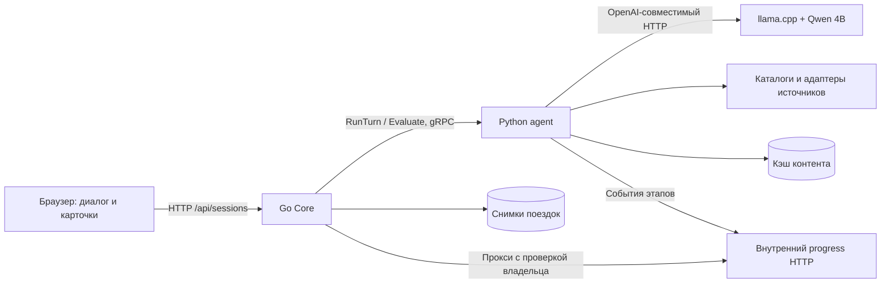

# Архитектура О!План

Актуальная конфигурация: корневой `docker-compose.yml`, Core + Python agent + локальная Qwen3-4B-Instruct-2507. UI и поездки обслуживает существующий Go Core; контракт Python/Go — gRPC. Отдельные Auth, Chat, Notif и их инфраструктура удалены из состава проекта. Пользовательский диалог, история и учебное оформление работают через сессии Core.

## Компоненты и поток данных

| Компонент | Ответственность | Исходники |
|---|---|---|
| `app` | UI, владение сессиями, ревизии, сохранение состояния, принятие изменений и учебный заказ | `backend/core/` |
| `agent` | Разбор пожеланий, направления, поиск, ранжирование, расчёты и проверки | `agent/travel_agent/`, `agent/main.py` |
| `model` | Генерация структурированного ответа по переданному контексту | `infra/model/`, `docs/docker-runtime.json` |
| UI | Диалог, карточки, сравнение, оформление, история и PDF | `backend/core/web/` |

Core публикуется на `127.0.0.1:8080`; внутри контейнера слушает `0.0.0.0:8080`. Агент (`50051`), его progress HTTP (`15052`) и модель (`8082`) доступны только в сети Compose. Сборка включает UI через `go:embed`. Процессы в контейнерах работают от непривилегированного пользователя.

## Обработка сообщения

1. Core проверяет cookie владельца, `expected_revision` и `idempotency_key`, загружает сохранённый снимок и передаёт его агенту.
2. `runner.run_turn` разбирает новое сообщение с учётом текущих условий, истории и показанных вариантов. Явные команды выбора и некоторые однозначные уточнения обрабатываются кодом. Остальные проходят через Qwen.
3. Ответ преобразуется в `Intent`/patch и валидируется. Цитаты связывают изменения с сообщением пользователя; дополнительные проверки защищают числа, даты, состав гостей и обязательные условия. Неизменённые поля сохраняются.
4. Если направления нет, агент выбирает до трёх вариантов из справочника. ID и факты проверяются сервером. Свободный подбор может вызвать модель дополнительно; при таймауте уже распознанные пожелания сохраняются для повтора.
5. Для выбранного направления адаптеры получают кандидатов. Код фильтрует условия, считает цену и ранжирует варианты. Неизвестное обязательное условие не считается выполненным.
6. Агент возвращает предложение `AgentTurn`. Core проверяет результат и сохраняет новый снимок с ревизией. Оформление выполняется отдельным явным действием пользователя.

Разбор допускает одну попытку исправления невалидного ответа. Подбор направления — отдельный этап, поэтому весь ход может содержать до трёх вызовов модели. Общий deadline в Compose — 300 с; его задаёт `AGENT_TURN_TIMEOUT_SECONDS`. Это верхний предел ожидания для медленного CPU, а не обязательная задержка. Ограничение в два вызова `ToolRegistry` относится к учебному пакетному пути, а не ко всем HTTP-запросам публичных адаптеров.

## Модель и готовность

Основной runtime — llama.cpp b11853, Qwen3-4B-Instruct-2507 Q4_K_M, веса 2 497 281 120 байт. Ревизия, SHA-256 и ARM64/AMD64 runtime закреплены в [docker-runtime.json](docker-runtime.json). Веса скачиваются в volume и не хранятся в Git.

Два слота используют одну модель: разбор условий и смысловой подбор направлений. Контекст каждого — 4096 токенов; default — 4 CPU-потока и общий лимит модели 5 GiB. Агент прогревает контексты перед открытием gRPC. Core показывает прогресс по файлу состояния модели, затем проверяет HTTP модели и health RPC агента. [Порядок запуска и диагностика](runtime.md).

`LLM_PROVIDER=llama_cpp` и `LLM_BASE_URL=http://model:8082/v1` — Docker-defaults. В коде существуют адаптеры других провайдеров; переключение переменных само по себе не отключает сервис `model` и ожидание его готовности в текущем Compose. Для внешнего inference потребуется отдельная конфигурация запуска и проверка. Нативный Mac-режим имеет собственный [манифест](local-runtime.json).

## Состояние и оформление

Договорённости описаны схемами [State, Intent, AgentTurn, Snapshot](../agent/schemas/). Деньги хранятся целыми копейками; суммы и разница вычисляются кодом. Бюджет всей поездки, услуг и только отеля различается; неизвестные даты или возраст ребёнка не заполняются произвольно.

Core хранит снимки и результаты операций в volume `trips`: запись через временный файл, `fsync` и переименование, блокировка на сессию. Повтор того же ключа с тем же телом возвращает сохранённый ответ; другой запрос с тем же ключом и устаревшая ревизия отклоняются. Хранилище рассчитано на один процесс Core.

`odin_local_owner` — HttpOnly/SameSite cookie, владелец проверяется при чтении и изменении поездки. Это локальный доступ без пользовательских аккаунтов. Для нескольких пользователей на публичном сервере потребуется интеграция с учётными записями и серверным хранилищем.

LLM не назначает авторитетную цену, не записывает состояние и не подтверждает покупку. Перед принятием варианта/оформлением Core проверяет актуальный состав через `Evaluate` и собственные ограничения. Изменения плана требуют принятия; подтверждённый учебный заказ хранит снимок состава, дат и суммы. PDF строится из сохранённой поездки. Реальная бронь, списание денег и отправка запросов отелю отсутствуют.

## Контракты и интерфейс

| Интерфейс | Назначение |
|---|---|
| gRPC `RunTurn(message, state_json, caller)` | Предложение нового состояния без записи и покупки |
| gRPC `Evaluate(state_json, plan_id, caller)` | Проверка выбранного варианта и расчёта без LLM |
| gRPC `Predict` | Проверка доступности процесса агента; используется bootstrap/healthcheck |
| `POST /api/sessions/`, `GET /api/sessions/` | Создание и история поездок владельца |
| `GET /api/sessions/{id}` | Сохранённый снимок |
| `POST /api/sessions/{id}/turns` | Сообщение с ревизией и ключом идемпотентности |
| `POST /api/sessions/{id}/actions` | Выбор, правки, принятие и учебное оформление |
| `GET /api/sessions/{id}/progress` | Реальные этапы обработки текущего запроса |
| `GET /api/sessions/{id}/context/{hotelID}` | Дополнительные сведения по отелю |
| `/api/shared/{token}` | Просмотр и импорт явно опубликованного плана |
| `/health`, `/ready`, `/api/runtime/status` | Живой процесс, готовность, подготовка |
| `/metrics` | Счётчик HTTP-запросов и их длительность |

Основной UI создаёт `search_mode=hotels`: он поддерживает отдельное размещение и полную поездку. Для явных действий используются `select_hotel`, `confirm_hotel_booking` и операции изменения компонентов. Учебный пакетный режим `/plan.html?mode=demo` имеет отдельные сессии и действия `select_plan`, `accept_change`, `confirm_booking_demo`. Прежние Auth-зависимые `/api/core/handle` и `/api/core/agent/turn` удалены.

В ходе запроса агент публикует реальные этапы через внутренний progress-сервис. Core проверяет владельца сессии и токен операции перед проксированием. Таймер в UI показывает время ожидания; процент готовности ответа не выдумывается.

## Источники и точки интеграции

| Область | Текущая реализация | Что требуется при внедрении |
|---|---|---|
| Контент/отзывы отелей | `ostrovok.py`, `public_content.py`: публичный HTML, кэш и происхождение сведений | Согласованный импорт или официальный контентный API |
| Стоимость/наличие | `hotel_selection.py`, `journey.py`: явные расчётные тарифы, фильтрация и сумма поездки | Провайдер доступности и тарифов на точные даты/гостей, проверка перед заказом |
| Дорога | `transport.py`, `travelpayouts.py`, `tutu.py`: расчёты и доступные справочные данные | Подтверждённые предложения, расписания и условия поставщика |
| Направления | `inspiration.py`, `direction_catalogue.json`: факты, ограничения, валидируемые ID | Расширение проверенного справочника и оценки пригодности |
| Погода/карта/места | Публичные источники, кэши и явные пределы доступных данных | Согласованные поставщики и лимиты эксплуатации |
| Сессии/заказ | Core, атомарные файлы, учебное подтверждение | Учётные записи, транзакционная БД и API бронирования/оплаты |

Сейчас публичные адаптеры вызываются из сценария агента; единый универсальный интерфейс поставщика для всех источников ещё не выделен. `ToolRegistry` описывает отдельный пакетный путь. При внедрении сохраняются модели поездки, проверки, gRPC и пользовательский сценарий, а перечисленные границы требуется адаптировать и проверить.

`JOURNEY_DATA_SOURCE=public` — основной источник полной поездки; `synthetic` — явно выбранный учебный каталог. `AGENT_TOOLS_MODE=demo` разрешает учебные инструменты и не заменяет настройку источника. Публичные карточки не подтверждают доступность номера на даты; транспортные кэши не являются реальным оформлением. [Подробные границы источников](public-data-sources.md).

## Проверки

[Команды разработки](development.md) включают Go race/vet/build, Python-тесты и проверку общего proto. Существующие отчёты фиксируют конкретную версию и конфигурацию: [CPU](validation/docker-cpu-2026-10-27/README.md), [AMD64](validation/amd64-2026-10-28/README.md), [подбор направлений](direction-selection.md). Результаты прежнего прогона не удостоверяют последующие изменения.
